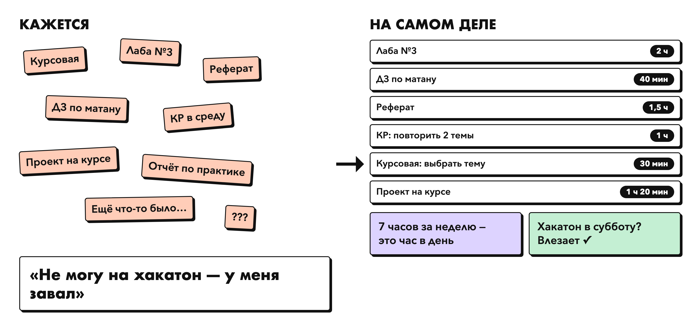
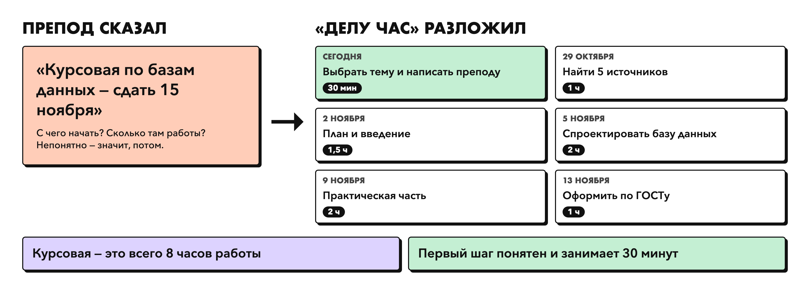
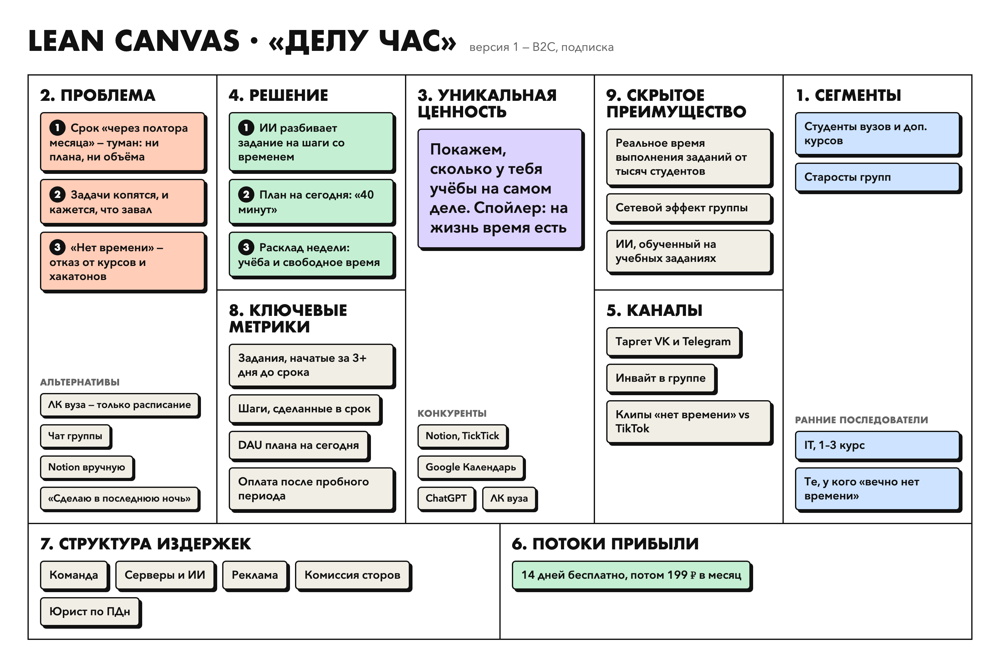
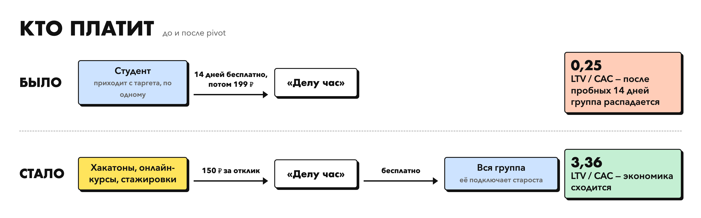
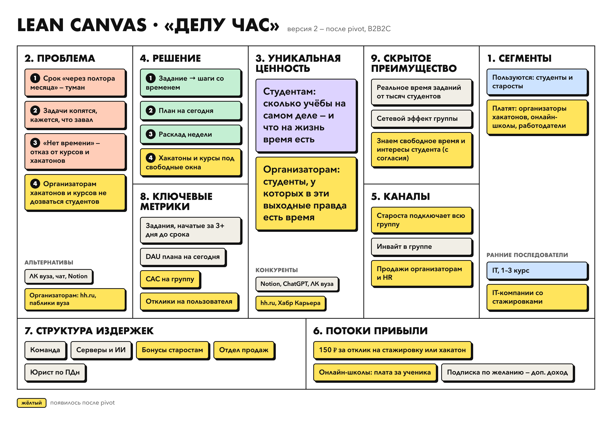
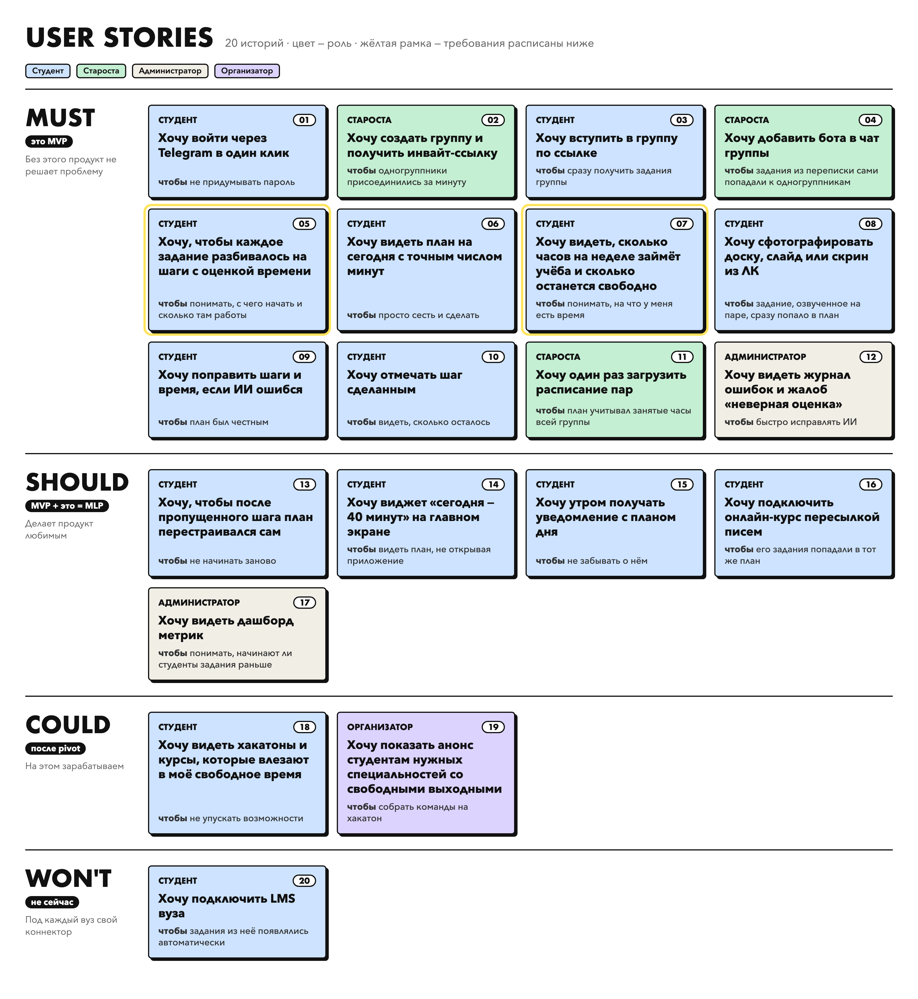
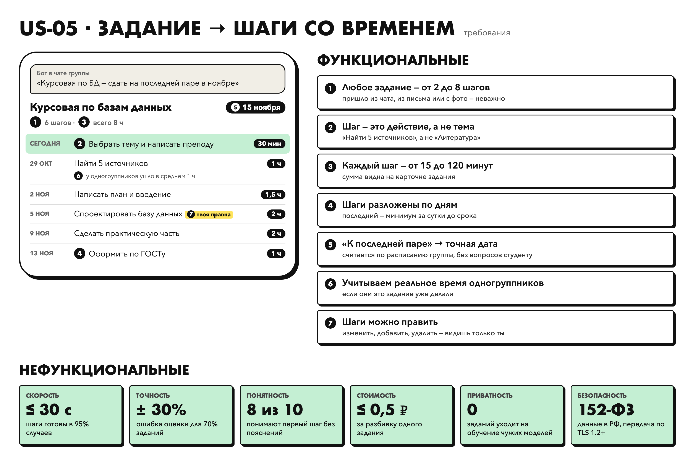
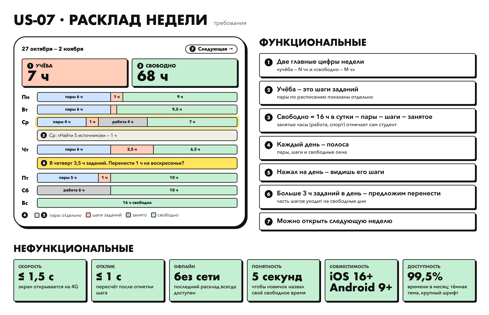

# Делу час

> Покажем, сколько у тебя учёбы на самом деле. Спойлер: на жизнь время есть.

**Навигация:** [ПЗ-1 · Идея](#пз-1--идея-и-бизнес-модель) · [ПЗ-2 · Гипотеза и экономика](#пз-2--гипотеза-экономика-и-pivot) · [ПЗ-3 · Требования](#пз-3--роли-истории-и-требования)

---

## ПЗ-1 · Идея и бизнес-модель

### Знакомо?

> **Сентябрь.** Препод: «Курсовая — к 15 ноября». Кажется, впереди вечность.
>
> **Октябрь.** Курсовая, две лабы, реферат, КР в среду. В голове одно: «у меня завал».
>
> **Пятница.** Друг зовёт на хакатон. «Не могу, мне лабы сдавать».
>
> **Вечер пятницы.** Три часа в TikTok. Лаба так и не начата, хотя работы там на час.

Студенту не лень, и времени ему хватает. Ему **не видно саму задачу**. Из срока «через полтора месяца» непонятно, с чего начать и сколько там работы. Такие задачи копятся и кажутся огромными. Студент откладывает их, а заодно отказывается от курсов, хакатонов и стажировок: «нет времени». Личный кабинет вуза тут не помогает: кроме расписания, в нём почти ничего нет.

### Бизнес-модель

| | |
|---|---|
| **Модель** | B2C, подписка с пробным периодом: 14 дней всё бесплатно, потом 199 ₽ в месяц |
| **Для кого** | Студенты вузов, особенно те, кто параллельно учится на онлайн-курсах |
| **Суть** | ИИ превращает размытые сроки в конкретные шаги с оценкой времени и показывает реальную нагрузку на неделю |

### Elevator Pitch

Каждый студент слышал «курсовая — к середине ноября» и откладывал её до последней недели. Дело не в лени: из такого срока непонятно, с чего начать и сколько там работы. Размытые задачи копятся, кажется, что завал, и студент отказывается от курсов и хакатонов: «нет времени». Хотя если честно посчитать, учёбы там на час в день. **«Делу час»** — приложение, которое разбивает каждое задание на конкретные шаги с оценкой времени, раскладывает их по дням до срока и показывает, сколько учёбы на неделе на самом деле. Личный кабинет вуза показывает, *когда* у тебя пары, а Notion и календари хранят задачи, но ни один из них не говорит, *сколько* на них уйдёт времени. Мы говорим: курсовая — это 8 часов, сегодня 30 минут. Студент видит «сегодня — 40 минут», делает и понимает, что на жизнь время есть. Первые 14 дней бесплатно, дальше — 199 ₽ в месяц. Сейчас мы запускаем пилот в нескольких учебных группах — хотите посмотреть прототип?

### Как это работает

1. **Задание приходит само.** Бот в чате группы замечает «курсовая к 15 ноября». Или студент фотографирует доску, слайд или скрин из ЛК, и задание распознаётся само.
2. **ИИ раскладывает его на шаги.** Каждый шаг — конкретное действие на 15–120 минут со своей датой.
3. **Студент видит реальную нагрузку.** Утром: «сегодня — 40 минут». На неделю: учёбы 7 часов, остальное время свободно.

### Lean Canvas

Текстовая версия

1. **Сегменты:** студенты вузов и онлайн-курсов, старосты. Ранние последователи: IT-направления 1–3 курса, те, у кого «вечно нет времени».
2. **Проблема:** (1) срок «через полтора месяца» размыт: нет ни плана, ни понимания объёма; (2) задачи копятся, кажется, что завал; (3) из-за «нет времени» студенты отказываются от курсов и хакатонов. Альтернативы: ЛК вуза (только расписание), чат группы, Notion вручную, «сделаю в последнюю ночь».
3. **Уникальная ценность:** покажем, сколько у тебя учёбы на самом деле, и что на жизнь время есть. Конкуренты: Notion, TickTick, Google Календарь, ChatGPT, ЛК вуза.
4. **Решение:** (1) ИИ разбивает задание на шаги с оценкой времени; (2) план на сегодня; (3) расклад недели: учёба и свободное время.
5. **Каналы:** таргет VK и Telegram, инвайт-ссылки в группе, короткие видео.
6. **Потоки прибыли:** подписка 199 ₽ в месяц после 14 бесплатных дней.
7. **Издержки:** команда, серверы и ИИ, реклама, комиссия магазинов приложений, юрист по персональным данным.
8. **Метрики:** доля заданий, начатых раньше чем за 3 дня до срока; шаги, сделанные в срок; DAU плана на сегодня; доля тех, кто платит после пробного периода.
9. **Скрытое преимущество:** реальное время выполнения заданий от тысяч студентов, сетевой эффект группы, ИИ, обученный на учебных заданиях.

---

## ПЗ-2 · Гипотеза, экономика и Pivot

### HADI-цикл

**Самый критичный риск — риск ценности.** Вся идея держится на том, что понятный план помогает начать раньше. Если студент увидит шаги и всё равно отложит работу на последнюю ночь, продукт бесполезен, сколько бы заданий он ни собрал.

| Шаг | Содержание |
|---|---|
| **H — гипотеза** | Если разбивать каждое задание на шаги с оценкой времени и каждое утро присылать «на сегодня — N минут», то не меньше 50% студентов начнут задания раньше чем за 3 дня до срока, потому что задача перестанет быть размытой |
| **A — действие** | Запускаем Telegram-бота в 10 группах на 4 недели. В 5 группах бот разбивает задания на шаги, в 5 других только напоминает о сроках. Шаги готовит ИИ, а команда проверяет их вручную перед отправкой (метод «Волшебника страны Оз») |
| **D — данные** | Доля заданий, начатых раньше чем за 3 дня до срока, в обеих половинах; доля сделанных шагов; насколько оценка времени совпала с фактом; опрос до и после: «Хватает ли тебе времени на что-то кроме учёбы?» |
| **I — вывод** | Если в группах с шагами показатель ≥ 50% и хотя бы вдвое выше, чем в группах с напоминаниями, строим приложение. Если нет, одного плана мало: проверяем следующую гипотезу, например общий прогресс группы |

### Юнит-экономика: исходная модель

Студент приходит по таргетированной рекламе VK, 14 дней пользуется бесплатно, потом платит 199 ₽ в месяц.

| | Расчёт | Итог |
|---|---|---|
| Воронка | 1 500 кликов → 30% установили → 50% начали пробный период → 15% оплатили после него | 34 платящих |
| **CAC** | 30 000 ₽ рекламы / 34 | **882 ₽** |
| Маржа | 199 ₽ − 30 ₽ комиссия магазина − 60 ₽ ИИ и серверы | 109 ₽ в месяц |
| **LTV** | 109 ₽ × 2 месяца (потом группа распадается и платящий уходит) | **218 ₽** |
| **LTV / CAC** | 218 / 882 | **0,25** при норме от 3 |

**Почему не сходится:**
- после пробного периода группа раскалывается: платит один из семи, а бот в чате и реальное время одногруппников без всей группы не работают;
- реклама приводит людей по одному, а продукт полезнее всей группе сразу;
- без группы польза падает, и платящие уходят через пару месяцев; летом и после выпуска отменяют все.

### План Б: Pivot

Меняем канал и того, кто платит.

- **Канал:** привлекаем не студента, а старосту. Он подключает бота к чату, и группа приходит целиком.
- **Деньги:** студент пользуется бесплатно. Платят организаторы хакатонов, онлайн-школы и работодатели. «Делу час» знает, когда у студента есть свободное время, и показывает подходящие события именно тогда. Это закрывает и третью проблему: на хакатон теперь «есть время».

| | Расчёт | Итог |
|---|---|---|
| Воронка | 1 староста → группа из 25 человек → 60% пользуются | 15 активных |
| **CAC** | (600 ₽ на привлечение старосты + 400 ₽ бонус ему) / 15 | **67 ₽** |
| Доход | отклики на хакатоны и стажировки 0,5 × 150 ₽ = 75 ₽, онлайн-школы 25 ₽, подписка по желанию 20 ₽ | 120 ₽ в год |
| Маржа | 120 ₽ − 45 ₽ на ИИ (5 ₽ × 9 учебных месяцев) | 75 ₽ в год |
| **LTV** | 75 ₽ × 3 года учёбы | **225 ₽** |
| **LTV / CAC** | 225 / 67 | **3,36** — сходится |

### Lean Canvas после pivot

---

## ПЗ-3 · Роли, истории и требования

### Роли

| Роль | Кто это | Что важно |
|---|---|---|
| Студент | Учится в вузе, часто ещё и на курсах | Понимать, что делать сегодня и сколько это займёт |
| Староста | Студент, который организует группу | Подключить группу один раз и не отвечать на «а что задали?» |
| Организатор | Хакатон, онлайн-школа или работодатель (появляется после pivot) | Найти студентов, у которых правда есть время |
| Администратор | Сотрудник команды «Делу час» | Видеть ошибки ИИ и исправлять их раньше, чем студенты разочаруются |

### User Stories и приоритеты (MoSCoW)

Таблица историй

| ID | Роль | История | MoSCoW |
|---|---|---|---|
| US-01 | Студент | Как студент, я хочу войти через Telegram в один клик, чтобы не придумывать пароль. | Must |
| US-02 | Староста | Как староста, я хочу создать группу и получить инвайт-ссылку, чтобы одногруппники присоединились за минуту. | Must |
| US-03 | Студент | Как студент, я хочу вступить в группу по инвайт-ссылке, чтобы сразу получить задания группы. | Must |
| US-04 | Староста | Как староста, я хочу добавить бота в чат группы, чтобы задания из переписки сами попадали к одногруппникам. | Must |
| US-05 | Студент | Как студент, я хочу, чтобы каждое задание разбивалось на шаги с оценкой времени, чтобы понимать, с чего начать и сколько там работы. | Must |
| US-06 | Студент | Как студент, я хочу видеть план на сегодня с точным числом минут, чтобы просто сесть и сделать. | Must |
| US-07 | Студент | Как студент, я хочу видеть расклад недели: сколько часов займёт учёба и сколько останется свободно, чтобы понимать, на что у меня есть время. | Must |
| US-08 | Студент | Как студент, я хочу сфотографировать доску, слайд или скрин из ЛК, чтобы задание, озвученное на паре, сразу попало в план. | Must |
| US-09 | Студент | Как студент, я хочу поправить шаги и время, если ИИ ошибся, чтобы план был честным. | Must |
| US-10 | Студент | Как студент, я хочу отмечать шаг сделанным, чтобы видеть, сколько осталось. | Must |
| US-11 | Староста | Как староста, я хочу один раз загрузить расписание пар, чтобы план учитывал занятые часы всей группы. | Must |
| US-12 | Администратор | Как администратор, я хочу видеть журнал ошибок и жалоб «неверная оценка», чтобы быстро исправлять ИИ. | Must |
| US-13 | Студент | Как студент, я хочу, чтобы после пропущенного шага план перестраивался сам, чтобы не начинать заново. | Should |
| US-14 | Студент | Как студент, я хочу виджет «сегодня — 40 минут» на главном экране, чтобы видеть план, не открывая приложение. | Should |
| US-15 | Студент | Как студент, я хочу получать утром уведомление с планом дня, чтобы не забывать о нём. | Should |
| US-16 | Студент | Как студент, я хочу подключить онлайн-курс пересылкой писем, чтобы его задания попадали в тот же план. | Should |
| US-17 | Администратор | Как администратор, я хочу видеть дашборд метрик, чтобы понимать, начинают ли студенты задания раньше. | Should |
| US-18 | Студент | Как студент, я хочу видеть хакатоны и курсы, которые помещаются в моё свободное время, чтобы не упускать возможности. | Could |
| US-19 | Организатор | Как организатор хакатона, я хочу показать анонс студентам нужных специальностей со свободными выходными, чтобы собрать команды. | Could |
| US-20 | Студент | Как студент, я хочу подключить LMS вуза, чтобы задания из неё появлялись автоматически. | Won't |

Каждая история проверена по INVEST: её можно сделать отдельно, она приносит пользу конкретной роли, помещается в один спринт, и понятно, как её проверить. US-20 отложена: под каждый вуз нужен свой коннектор, в один спринт это не помещается. US-18 и US-19 после pivot становятся главным источником дохода.

### MVP и MLP

| | Истории | Что получает пользователь |
|---|---|---|
| **MVP** | US-01 – US-12 | Задание приходит, раскладывается на шаги, видно план на день и нагрузку на неделю |
| **MLP** | MVP + US-13 – US-17 | План подстраивается сам, виджет, утреннее уведомление, онлайн-курсы в том же плане |
| **После pivot** | US-18, US-19 | Хакатоны и курсы под свободное время — на этом зарабатываем |

### Требования к ключевым историям MVP

#### US-05 · Задание раскладывается на шаги со временем

Требования текстом

**Функциональные**

| № | Требование |
|---|---|
| 1 | Для каждого нового задания (из чата, письма или с фото) система создаёт от 2 до 8 шагов |
| 2 | Шаг — конкретное действие с результатом («Найти 5 источников»), а не тема («Литература») |
| 3 | У каждого шага есть оценка от 15 до 120 минут, на карточке задания видна общая сумма |
| 4 | Шаги распределяются по дням до срока, последний — не позже чем за сутки до дедлайна |
| 5 | Если срок указан относительно («к следующей паре», «через две недели»), дата вычисляется по расписанию группы, без вопросов студенту |
| 6 | Если одногруппники уже сделали это задание, оценка учитывает их фактическое время |
| 7 | Студент может изменить, добавить или удалить шаг; правки видит только он |

**Нефункциональные**

| Тип | Требование |
|---|---|
| Скорость | Шаги готовы не позже чем через 30 секунд после появления задания в 95% случаев |
| Точность | Для 70% заданий фактическое время отличается от оценки не больше чем на 30% |
| Понятность | В юзабилити-тесте 8 из 10 студентов понимают первый шаг без пояснений |
| Стоимость | Разбивка одного задания стоит не дороже 0,5 ₽ |
| Приватность | Тексты заданий не используются для обучения сторонних моделей |
| Безопасность | Персональные данные хранятся в РФ (152-ФЗ) и передаются только по TLS 1.2 и выше |

#### US-07 · Расклад недели

Требования текстом

**Функциональные**

| № | Требование |
|---|---|
| 1 | Экран показывает две главные цифры на неделю: «учёба — N ч» и «свободно — M ч» |
| 2 | Учёба — это шаги заданий на эту неделю; пары по расписанию показаны отдельно |
| 3 | Свободное время = 16 часов в сутки минус пары, шаги и занятые часы, которые указал студент |
| 4 | Каждый день показан полосой: пары, шаги и свободные окна |
| 5 | Нажатие на день открывает его шаги |
| 6 | Если в какой-то день больше 3 часов заданий, система предлагает перенести часть шагов на свободные дни |
| 7 | Можно переключиться на следующую неделю |

**Нефункциональные**

| Тип | Требование |
|---|---|
| Скорость | Экран открывается не дольше 1,5 секунды на мобильном интернете 4G |
| Отклик | После отметки шага цифры пересчитываются не дольше чем за 1 секунду |
| Офлайн | Последний расклад доступен без интернета |
| Понятность | Новый пользователь за 5 секунд отвечает, сколько у него свободного времени на неделе |
| Совместимость | iOS 16+ и Android 9+ |
| Доступность | Сервис работает 99,5% времени в месяц; есть тёмная тема и системный размер шрифта |

