# Делу час — знай, сколько учёбы, и живи спокойно

> Покажем, сколько у тебя на самом деле учёбы. Спойлер: на жизнь время есть.

**Навигация:** [ПЗ-1 · Идея](#пз-1--идея-и-бизнес-модель) · [ПЗ-2 · Гипотезы и экономика](#пз-2--гипотезы-экономика-и-pivot) · [ПЗ-3 · Требования](#пз-3--роли-истории-и-требования) · [ПЗ-4 · Архитектура](#пз-4--домены-сценарии-экраны-и-api) · [ПЗ-5 · C4 и стек](#пз-5--c4-и-стек-технологий)

---

## ПЗ-1 · Идея и бизнес-модель

### С чего всё началось

> **Сентябрь.** Препод: "Курсовая — к 15 ноября". Кажется, впереди вечность.
>
> **Октябрь.** Курсовая, две лабы, реферат, КР в среду. В голове одно: "у меня завал".
>
> **Пятница.** Друг зовёт на хакатон. "Не могу, мне лабы сдавать".
>
> **Вечер пятницы.** Три часа в TikTok. Лаба так и не начата, хотя работы там на час.

Мы сами так жили весь прошлый год. Проблема, как нам кажется, не в лени и не в нехватке времени. Просто когда тебе говорят "курсовая к 15 ноября", непонятно, с чего начать и сколько это вообще займёт. Таких заданий набирается штук пять, и в голове они выглядят как **огромный завал**. В итоге всё откладывается, а заодно отменяются хакатоны, курсы, стажировки, потому что "нет времени". ЛК вуза тут не помогает, там по сути только расписание.

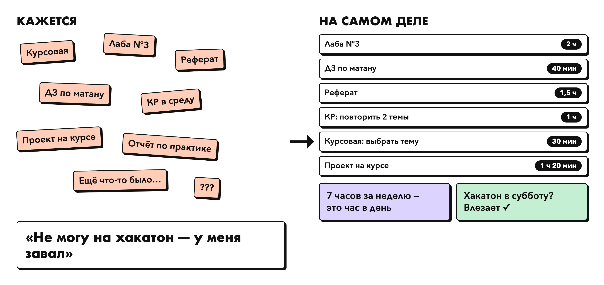

### Бизнес-модель

| | |
|---|---|
| **Модель** | B2C, подписка с пробным периодом: 14 дней всё бесплатно, потом 199 ₽ в месяц |
| **Для кого** | Студенты вузов, особенно те, кто параллельно учится на онлайн-курсах |
| **Суть** | ИИ разбивает задание на шаги, прикидывает время на каждый и показывает, сколько учёбы реально набирается за неделю |

### Elevator Pitch

Почти каждый студент откладывает курсовую до последней недели. Срок вроде далеко, с чего начать непонятно, сколько работы тоже. Задания копятся, кажется что завал, и от хакатонов и курсов студент отказывается, хотя если посчитать, учёбы там примерно на час в день.

"Делу час" разбивает каждое задание на шаги, оценивает время на каждый и раскладывает их по дням до срока. Утром студент видит "сегодня 40 минут" и делает, а в расписании недели видно, сколько времени остаётся свободным. В ЛК вуза есть только расписание пар, в Notion и календарях задачи хранятся, но сколько на них уйдёт времени, никто не считает. Мы считаем.

14 дней бесплатно, потом 199 ₽ в месяц. Хотим начать с пилота в нескольких группах.

### Как это работает

1. **Задание попадает в приложение.** Бот сидит в чате группы и ловит сообщения вроде "курсовая к 15 ноября". Если задание дали устно на паре, можно сфоткать доску, слайд или скрин из ЛК.
2. **ИИ разбивает его на шаги.** Каждый шаг занимает от 15 минут до 2 часов, и у каждого своя дата.
3. **Студент видит, сколько работы.** Утром приходит "сегодня 40 минут", а на экране недели видно, например, что учёбы 7 часов, а остальное время свободно.

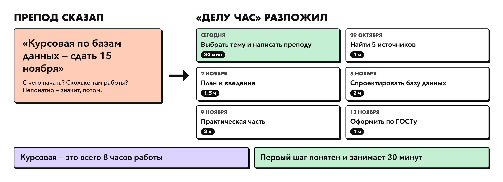

### Lean Canvas

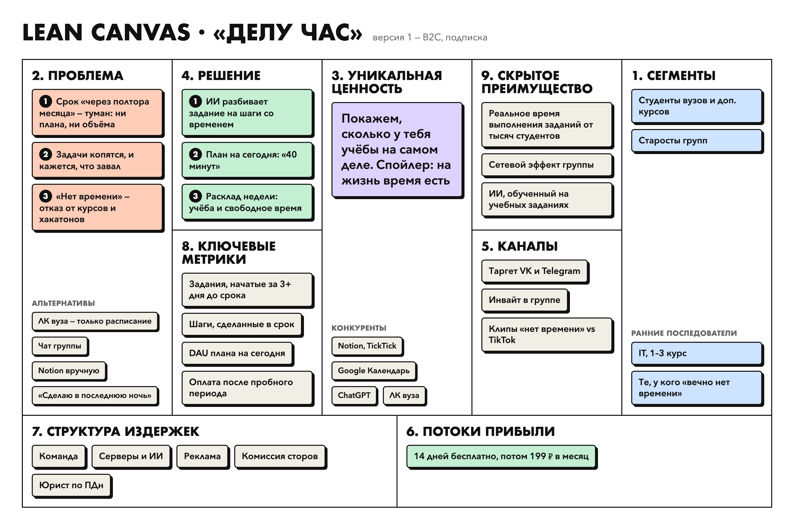

<details>
<summary>Текстовая версия</summary>

1. **Сегменты:** студенты вузов и онлайн-курсов, старосты. Ранние последователи: IT-направления 1–3 курса, те, у кого "вечно нет времени".
2. **Проблема:** (1) срок "через полтора месяца" размыт: нет ни плана, ни понимания объёма; (2) задачи копятся, кажется, что завал; (3) из-за "нет времени" студенты отказываются от курсов и хакатонов. Альтернативы: ЛК вуза (только расписание), чат группы, Notion вручную, "сделаю в последнюю ночь".
3. **Уникальная ценность:** покажем, сколько у тебя учёбы на самом деле, и что на жизнь время есть. Конкуренты: Notion, TickTick, Google Календарь, ChatGPT, ЛК вуза.
4. **Решение:** (1) ИИ разбивает задание на шаги с оценкой времени; (2) план на сегодня; (3) расклад недели: учёба и свободное время.
5. **Каналы:** таргет VK и Telegram, инвайт-ссылки в группе, короткие видео.
6. **Потоки прибыли:** подписка 199 ₽ в месяц после 14 бесплатных дней.
7. **Издержки:** команда, серверы и ИИ, реклама, комиссия магазинов приложений, юрист по персональным данным.
8. **Метрики:** доля заданий, начатых раньше чем за 3 дня до срока; шаги, сделанные в срок; DAU плана на сегодня; доля тех, кто платит после пробного периода.
9. **Скрытое преимущество:** реальное время выполнения заданий от тысяч студентов, сетевой эффект группы, ИИ, обученный на учебных заданиях.

</details>

---

## ПЗ-2 · Гипотезы, экономика и Pivot

### Две ключевые гипотезы

| | Гипотеза | Какой риск | Если не подтвердится |
|---|---|---|---|
| **H1** | Студенты будут работать по плану. Утром приходит конкретный шаг, например "на сегодня 30 минут: найти 5 источников". Студент делает его в тот же день, и в итоге курсовую начинает за месяц до срока | **Ценность:** будут ли вообще делать то, что написано в плане | Шаги видят, но всё равно откладывают. Тогда продукт не нужен, как бы хорошо он ни раскладывал задания |
| **H2** | Не меньше 70% заданий студенты получают через чат группы, письмо или то, что можно сфотографировать (доска, слайд, скрин из ЛК). Значит, их можно поймать без ручного ввода | **Осуществимость:** сможем ли мы собирать задания сами | Задания придётся вбивать руками, и студент скорее всего бросит. А без заданий нет и плана |

**Главная — H1.** Если по плану никто не работает, неважно, как задания в него попадают. Поэтому проверяем её первой.

### HADI-цикл для H1

Проверяем без кода: приложения и бота пока нет, их работу вручную делаем мы через обычный Telegram.

| Шаг | Содержание |
|---|---|
| **H — гипотеза** | Если каждое утро присылать студенту один-два конкретных шага с оценкой времени, то не меньше 60% шагов он сделает в назначенный день, а не меньше 50% заданий будут начаты раньше чем за 3 дня до срока |
| **A — действие** | Берём 6 групп по договорённости со старостами, срок — 3 недели. Член команды вступает в чат группы как обычный участник и выписывает задания. Шаги он готовит вручную с помощью ChatGPT и каждое утро пишет студентам в личку "на сегодня — N минут". В 3 группах так, в 3 других — только напоминание о сроке. Отметку "сделал" студент ставит в обычном опросе Telegram |
| **D — данные** | Доля шагов, сделанных **в назначенный день**, и доля сделанных позже; доля дней, когда студент ответил на утреннее сообщение, по неделям: не бросают ли к третьей; доля заданий, начатых раньше чем за 3 дня до срока, в обеих половинах; опрос до и после: "Хватает ли тебе времени на что-то кроме учёбы?" |
| **I — вывод** | **Оба порога выполнены** и показатель вдвое выше, чем в группах с напоминаниями: H1 подтверждена, проверяем H2 и только потом пишем код. **Шаги делают, но не в свой день:** план помогает, но расписание по дням не работает. Оставляем список шагов без жёстких дат. **К третьей неделе перестают отвечать:** формат утреннего сообщения надоедает. Меняем его и повторяем цикл. **Ничего не изменилось:** одного плана мало, продукт в этом виде не нужен |

### Как проверим H2

Тут тоже обойдёмся без кода, через дневник заданий. Берём 6–8 групп с трёх разных факультетов на 2 недели.
- Каждое новое задание студент пересылает в общий чат исследования с тегом источника: `#чат`, `#устно`, `#доска`, `#почта`, `#ЛК`, `#LMS`.
- В конце недели сверяем со старостой: не пропущено ли что-то.

По итогам решаем так:
- **От 70% из "ловимых" источников:** ввод работает как задумано (US-04, US-08, US-16).
- **Много `#устно` без доски:** нужен быстрый голосовой ввод.
- **Много `#LMS`:** US-20 поднимаем из Won't.

### Юнит-экономика: исходная модель

Студент приходит по таргетированной рекламе VK, 14 дней пользуется бесплатно, потом платит 199 ₽ в месяц.

| | Расчёт | Итог |
|---|---|---|
| Воронка | 1 500 кликов → 30% установили → 50% начали пробный период → 15% оплатили после него | 34 платящих |
| **CAC** | 30 000 ₽ рекламы / 34 | **882 ₽** |
| Маржа | 199 ₽ − 30 ₽ комиссия магазина − 60 ₽ ИИ и серверы | 109 ₽ в месяц |
| **LTV** | 109 ₽ × 2 месяца (потом группа распадается и платящий уходит) | **218 ₽** |
| **LTV / CAC** | 218 / 882 | **0,25** при норме от 3 |

Сначала мы думали, что студенты будут платить сами. Посчитали, и не сошлось. Почему:
- после пробного периода платит примерно один из семи в группе, а бот в чате и время одногруппников работают, только если в приложении вся группа;
- реклама приводит людей по одному, а пользы больше, когда приходит вся группа сразу;
- без группы приложение становится менее полезным, и через пару месяцев подписку отменяют. Летом и после выпуска тем более.

### План Б: Pivot

Поэтому поменяли две вещи: как приходят пользователи и кто платит.

- **Канал.** Идём к старостам. Староста подключает бота к чату, и вместе с ним приходит вся группа.
- **Деньги.** Для студента приложение бесплатное. Платят организаторы хакатонов, онлайн-школы и работодатели. Мы знаем, когда у студента есть свободное время, и как раз тогда показываем ему подходящие события. Заодно решается третья проблема: на хакатон теперь "есть время".

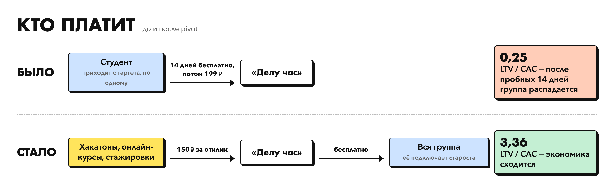

| | Расчёт | Итог |
|---|---|---|
| Воронка | 1 староста → группа из 25 человек → 60% пользуются | 15 активных |
| **CAC** | (600 ₽ на привлечение старосты + 400 ₽ бонус ему) / 15 | **67 ₽** |
| Доход | отклики на хакатоны и стажировки 0,5 × 150 ₽ = 75 ₽, онлайн-школы 25 ₽, подписка по желанию 20 ₽ | 120 ₽ в год |
| Маржа | 120 ₽ − 45 ₽ на ИИ (5 ₽ × 9 учебных месяцев) | 75 ₽ в год |
| **LTV** | 75 ₽ × 3 года учёбы | **225 ₽** |
| **LTV / CAC** | 225 / 67 | **3,36**, сходится |

**А если продавать вузу или деканату?** Думали об этом, но пока отложили:
- **это долго.** Вуз закупает через тендер, с пилотом и проверкой по 152-ФЗ, это 6–12 месяцев;
- **у деканата другая боль.** Ему важно, чтобы было меньше долгов и отчислений. Что наш план на это влияет, ещё надо доказать;
- **студенты перестанут доверять.** Если платит вуз, легко подумать, что деканат видит, кто ничего не делает.

К этой идее можно вернуться, если пилот покажет, что долгов стало меньше.

### Lean Canvas после pivot

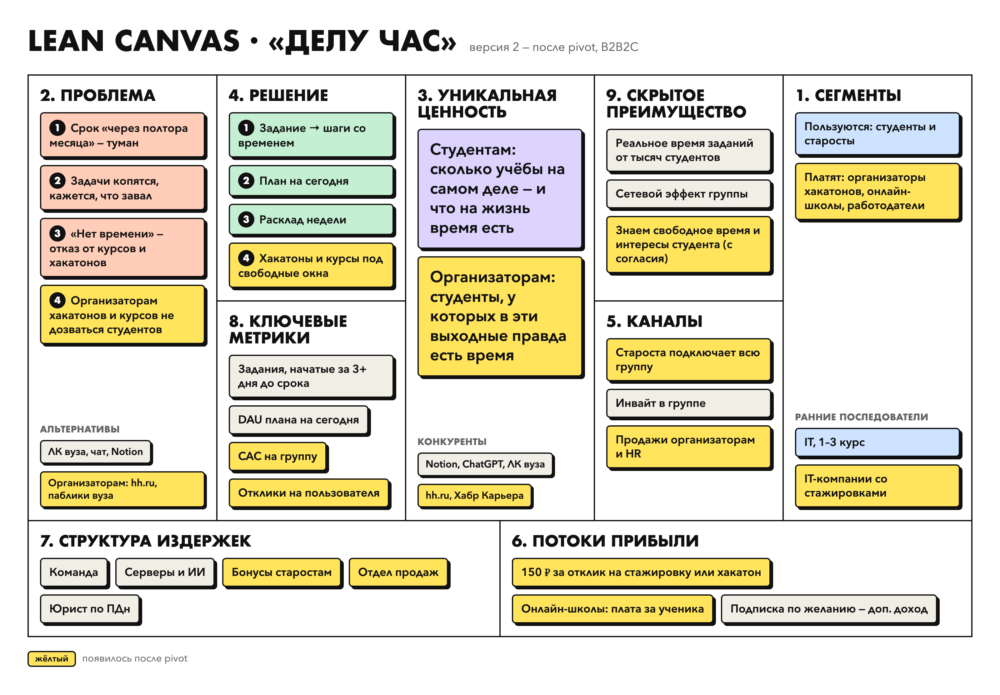

---

## ПЗ-3 · Роли, истории и требования

### Роли

| Роль | Кто это | Что важно |
|---|---|---|
| Студент | Учится в вузе, часто ещё и на курсах | Понимать, что делать сегодня и сколько это займёт |
| Староста | Студент, который организует группу | Подключить группу один раз и больше не отвечать на "а что задали?" |
| Организатор | Хакатон, онлайн-школа или работодатель (появляется после pivot) | Найти студентов, у которых правда есть время |
| Администратор | Сотрудник команды "Делу час" | Видеть ошибки ИИ и исправлять их раньше, чем студенты разочаруются |

### User Stories и приоритеты (MoSCoW)

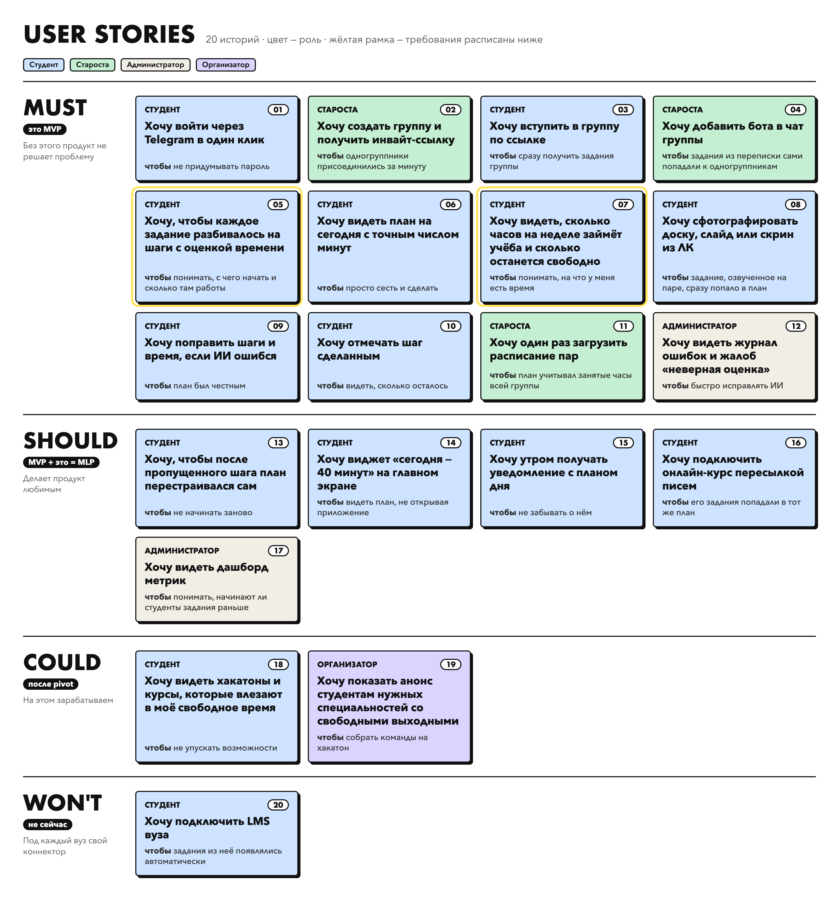

<details>
<summary>Таблица историй</summary>

| ID | Роль | История | MoSCoW |
|---|---|---|---|
| US-01 | Студент | Как студент, я хочу войти через Telegram в один клик, чтобы не придумывать пароль. | Must |
| US-02 | Староста | Как староста, я хочу создать группу и получить инвайт-ссылку, чтобы одногруппники присоединились за минуту. | Must |
| US-03 | Студент | Как студент, я хочу вступить в группу по инвайт-ссылке, чтобы сразу получить задания группы. | Must |
| US-04 | Староста | Как староста, я хочу добавить бота в чат группы, чтобы задания из переписки сами попадали к одногруппникам. | Must |
| US-05 | Студент | Как студент, я хочу, чтобы каждое задание разбивалось на шаги с оценкой времени, чтобы понимать, с чего начать и сколько там работы. | Must |
| US-06 | Студент | Как студент, я хочу видеть план на сегодня с точным числом минут, чтобы просто сесть и сделать. | Must |
| US-07 | Студент | Как студент, я хочу видеть расклад недели: сколько часов займёт учёба и сколько останется свободно, чтобы понимать, на что у меня есть время. | Must |
| US-08 | Студент | Как студент, я хочу сфотографировать доску, слайд или скрин из ЛК, чтобы задание, озвученное на паре, сразу попало в план. | Must |
| US-09 | Студент | Как студент, я хочу поправить шаги и время, если ИИ ошибся, чтобы план был честным. | Must |
| US-10 | Студент | Как студент, я хочу отмечать шаг сделанным, чтобы видеть, сколько осталось. | Must |
| US-11 | Староста | Как староста, я хочу один раз загрузить расписание пар, чтобы план учитывал занятые часы всей группы. | Must |
| US-12 | Администратор | Как администратор, я хочу видеть журнал ошибок и жалоб "неверная оценка", чтобы быстро исправлять ИИ. | Must |
| US-13 | Студент | Как студент, я хочу, чтобы план перестраивался сам после пропущенного шага или новой отметки "занят", чтобы не начинать заново. | Should |
| US-14 | Студент | Как студент, я хочу виджет "сегодня — 40 минут" на главном экране, чтобы видеть план, не открывая приложение. | Should |
| US-15 | Студент | Как студент, я хочу получать утром уведомление с планом дня, чтобы не забывать о нём. | Should |
| US-16 | Студент | Как студент, я хочу подключить онлайн-курс пересылкой писем, чтобы его задания попадали в тот же план. | Should |
| US-17 | Администратор | Как администратор, я хочу видеть дашборд метрик, чтобы понимать, начинают ли студенты задания раньше. | Should |
| US-18 | Студент | Как студент, я хочу видеть хакатоны и курсы, которые помещаются в моё свободное время, чтобы не упускать возможности. | Could |
| US-19 | Организатор | Как организатор хакатона, я хочу показать анонс студентам нужных специальностей со свободными выходными, чтобы собрать команды. | Could |
| US-20 | Студент | Как студент, я хочу подключить LMS вуза, чтобы задания из неё появлялись автоматически. | Won't |

</details>

Все истории проверили по INVEST: каждую можно сделать отдельно, она полезна конкретной роли, влезает в один спринт, и понятно, как её проверить. US-20 отложили, потому что под каждый вуз пришлось бы писать свой коннектор, в спринт это не влезет. US-18 и US-19 нужны после pivot, на них держится доход.

### MVP и MLP

| | Истории | Что получает пользователь |
|---|---|---|
| **MVP** | US-01 – US-12 | Задание приходит, раскладывается на шаги, видно план на день и нагрузку на неделю |
| **MLP** | MVP + US-13 – US-17 | План подстраивается сам, виджет, утреннее уведомление, онлайн-курсы в том же плане |
| **После pivot** | US-18, US-19 | Хакатоны и курсы под свободное время, на этом и зарабатываем |

### Требования к ключевым историям MVP

Требования старались писать так, чтобы их можно было проверить: в каждом есть число или условие. На картинке под таблицами показано, где каждое требование видно на экране.

#### US-05 · Задание раскладывается на шаги со временем

**Функциональные**

| № | Требование |
|---|---|
| ФТ-1 | Система должна создавать для каждого нового задания (из чата группы, письма или фото) от 2 до 8 шагов |
| ФТ-2 | Название шага должно начинаться с глагола и называть проверяемый результат: число, файл или отправленное сообщение ("Найти 5 источников", а не "Литература") |
| ФТ-3 | Система должна давать каждому шагу оценку от 15 до 120 минут и показывать на карточке задания общую сумму |
| ФТ-4 | Система должна раскладывать шаги по дням до срока так, чтобы последний шаг стоял не позже чем за 24 часа до дедлайна. Шаги не ставятся на пары и на часы, которые студент отметил занятыми. Если до срока не хватает свободного времени, система предупреждает студента |
| ФТ-5 | Если срок указан относительно ("к следующей паре", "через две недели"), система должна вычислить дату по расписанию группы, не задавая вопросов студенту |
| ФТ-6 | Если шаг этого задания уже сделали не меньше 5 одногруппников, система должна заменить оценку ИИ медианой их фактического времени |
| ФТ-7 | Студент должен иметь возможность изменить, добавить или удалить шаг; правки видит только он |

**Нефункциональные**

| Тип | Требование |
|---|---|
| Скорость | Шаги готовы не позже чем через 30 секунд после появления задания в 95% случаев |
| Точность | Для 70% заданий фактическое время отличается от оценки не больше чем на 30% |
| Понятность | В юзабилити-тесте 8 из 10 студентов понимают первый шаг без пояснений |
| Стоимость | Разбивка одного задания стоит не дороже 0,5 ₽ |
| Приватность | Тексты заданий не передаются на обучение сторонних моделей; это закреплено в договоре с поставщиком ИИ |
| Безопасность | Персональные данные хранятся в РФ (152-ФЗ) и передаются только по TLS 1.2 и выше |

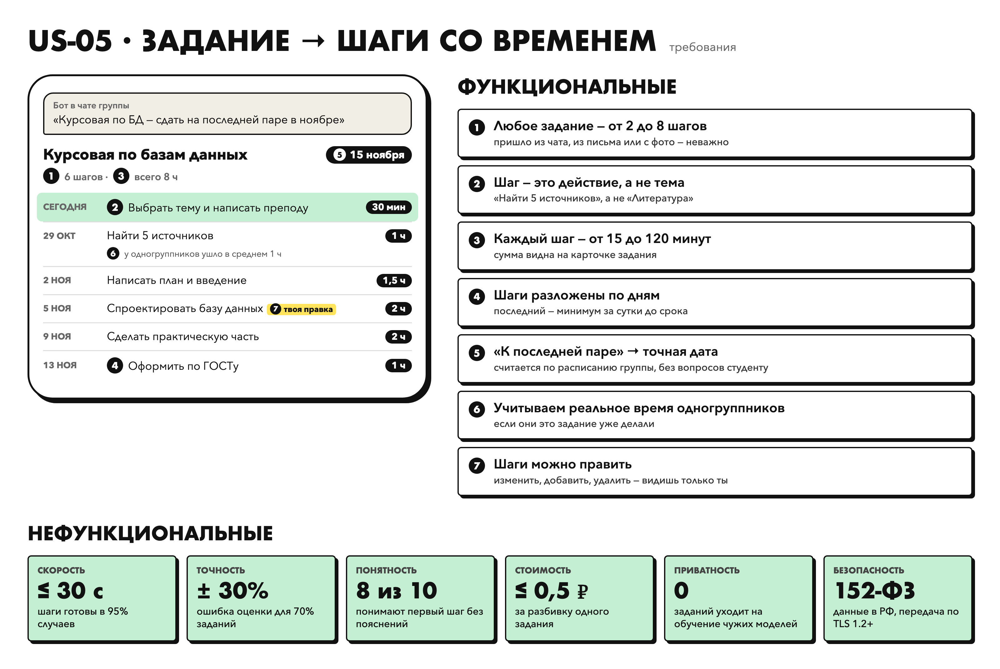

#### US-07 · Расклад недели

**Функциональные**

| № | Требование |
|---|---|
| ФТ-1 | Экран должен показывать две цифры за текущую неделю (пн–вс): "учёба — N ч" и "свободно — M ч", округлённые до 0,5 часа |
| ФТ-2 | "Учёба" — это сумма оценок шагов на этой неделе; пары в неё не входят и показываются отдельно |
| ФТ-3 | Свободное время = 16 ч × 7 дней − пары − шаги − занятые часы. Занятость студент отмечает сам: разово ("пятница 19–23") или регулярно ("работа по субботам 10–16") |
| ФТ-4 | Каждый день показан полосой из четырёх частей: пары, шаги, занято, свободно |
| ФТ-5 | Нажатие на день должно открывать список его шагов со временем |
| ФТ-6 | Если на день приходится больше 3 часов шагов, система должна предложить перенести лишнее на самый свободный день до срока; перенос — только после подтверждения студента |
| ФТ-7 | Студент должен иметь возможность переключиться на следующую неделю |

**Нефункциональные**

| Тип | Требование |
|---|---|
| Скорость | В 95% случаев экран открывается не дольше 1,5 секунды на мобильном интернете 4G |
| Отклик | После отметки шага цифры пересчитываются не дольше чем за 1 секунду |
| Офлайн | Без интернета экран показывает последний расклад и время его обновления; отметки шагов сохраняются и отправляются, когда сеть появится |
| Понятность | 8 из 10 новых пользователей за 5 секунд называют своё свободное время на неделе |
| Совместимость | iOS 16+ и Android 9+ |
| Надёжность | Сервис доступен не меньше 99,5% времени в месяц |
| Доступность для всех | Тёмная тема; системный шрифт до 200% без обрезки текста; контраст текста не ниже 4,5 : 1 (WCAG AA) |

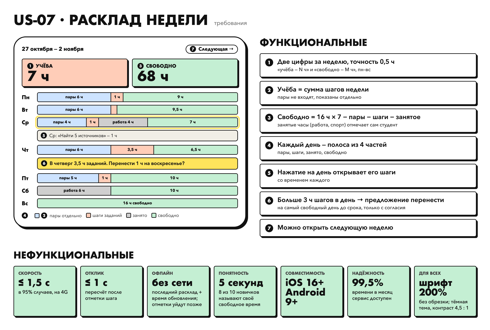

---

## ПЗ-4 · Домены, сценарии, экраны и API

### Доменные зоны (DDD)

Делим продукт на пять зон. У каждой своя задача и свои данные, а с соседями она общается только событиями: "задание получено", "шаги готовы", "план изменился". Каждую зону может вести отдельная команда и выпускать её, не дожидаясь остальных.

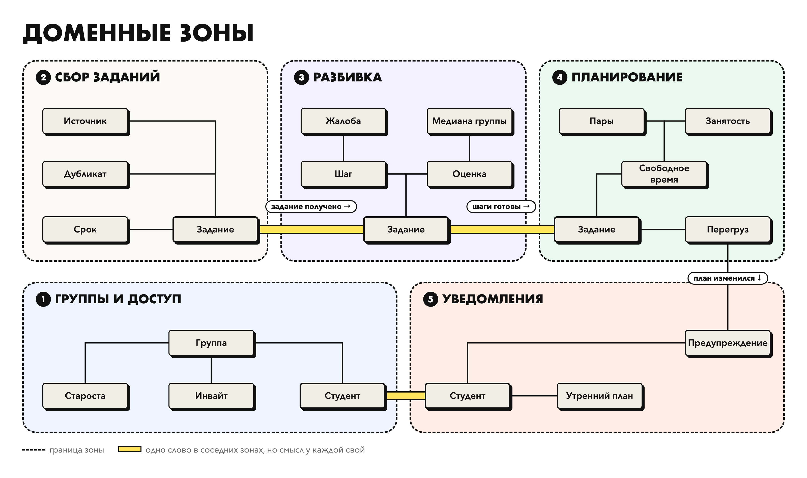

| Зона | За что отвечает | Истории |
|---|---|---|
| 1. Группы и доступ | Кто есть кто: вход через Telegram, группы, инвайты, роли | US-01–03 |
| 2. Сбор заданий | Ловит задания из чата, фото и писем, находит срок | US-04, 08, 16 |
| 3. Разбивка | Делит задание на шаги с минутами, следит за качеством ИИ | US-05, 09, 12 |
| 4. Планирование | Раскладывает шаги по свободным часам, видит перегрузы | US-06, 07, 10, 11, 13 |
| 5. Уведомления | Сообщает студенту о плане и о проблемах | US-14, 15 |

<details>
<summary>Глоссарии зон</summary>

**1. Группы и доступ**

| Термин | Значение здесь |
|---|---|
| Студент | Аккаунт, привязанный к Telegram ID |
| Группа | Учебная группа: староста, участники и чат |
| Староста | Участник группы, который может подключить бота и загрузить расписание |
| Инвайт | Ссылка, по которой студент вступает в группу |

**2. Сбор заданий**

| Термин | Значение здесь |
|---|---|
| Источник | Откуда пришло задание: чат группы, фото или письмо |
| Задание | Текст или фото как есть, ещё без шагов |
| Срок | Дата и время сдачи. Относительный срок ("к следующей паре") пересчитывается по расписанию |
| Дубликат | То же задание, присланное ещё раз; второй раз не создаётся |

**3. Разбивка**

| Термин | Значение здесь |
|---|---|
| Задание | Описание, которое надо разбить на 2–8 шагов |
| Шаг | Действие с глаголом и проверяемым результатом, 15–120 минут |
| Оценка | Сколько минут займёт шаг; считает ИИ или берётся медиана группы |
| Медиана группы | Реальное время шага у 5 и больше одногруппников; заменяет оценку ИИ |
| Жалоба | Отметка студента "оценка неверная" |

**4. Планирование**

| Термин | Значение здесь |
|---|---|
| Задание | Шаги, которые надо уложить до срока |
| Пары | Занятые часы из расписания группы |
| Занятость | Часы, которые студент отметил сам: работа, спорт |
| Свободное время | 16 ч в день − пары − шаги − занятость |
| Перегруз | Больше 3 часов шагов в один день |

**5. Уведомления**

| Термин | Значение здесь |
|---|---|
| Студент | Получатель с часовым поясом и временем тишины |
| Утренний план | Сообщение с шагами и минутами на сегодня |
| Предупреждение | Сообщение о перегрузе или о том, что задание не влезает |

</details>

### Критический путь MVP (BDD)

Путь: задание появилось в чате группы, и студент видит его разбитым на шаги и разложенным по дням. На этом держится H1: если задание не попадает в план само, по плану никто не работает.

**Сценарий успеха: задание попадает в план само**

```text
Дано:  студентка Аня состоит в группе ИУ5-31Б, бот добавлен в чат группы
И:     расписание пар группы загружено
И:     сегодня 10 ноября, до 20 ноября у Ани 30 свободных часов
Когда: староста пишет в чат "Реферат по истории к 20.11, 10–15 страниц"
Тогда: не позже чем через 30 секунд на экране "Сегодня" у Ани появляется
       плашка "Новое задание: Реферат по истории"
И:     в карточке задания от 2 до 8 шагов, у каждого от 15 до 120 минут,
       всего 4 ч 30 мин
И:     ни один шаг не стоит на парах или занятых часах
И:     последний шаг стоит не позже 19 ноября, то есть за сутки до срока
```

**Сценарий отказа: задание не влезает до срока**

```text
Дано:  Аня состоит в группе ИУ5-31Б, расписание загружено
И:     сегодня 10 ноября, до 12 ноября у Ани только 2 свободных часа
Когда: староста пишет в чат "Реферат по истории к 12.11"
Тогда: задание всё равно создаётся, его шаги занимают 4 ч 30 мин
И:     система не ставит шаги на пары и занятые часы
И:     в карточке появляется жёлтая плашка "До срока свободно 2 ч, а нужно 4,5 ч"
И:     предлагаются три варианта: "Сократить шаги",
       "Отметить, что я свободна", "Оставить как есть"
И:     шаги, которые не влезли, остаются без дня
И:     если Аня нажмёт "Оставить как есть", плашка сворачивается
       в метку "2 шага без дня", а сами шаги никуда не пропадают
```

### Экраны критического пути (wireframes)

Три экрана, по которым Аня проходит в этих сценариях. Чат группы не рисуем: это Telegram, а не наш интерфейс.

**Экран 1.** Задание пришло само, Аня видит его на главном экране.

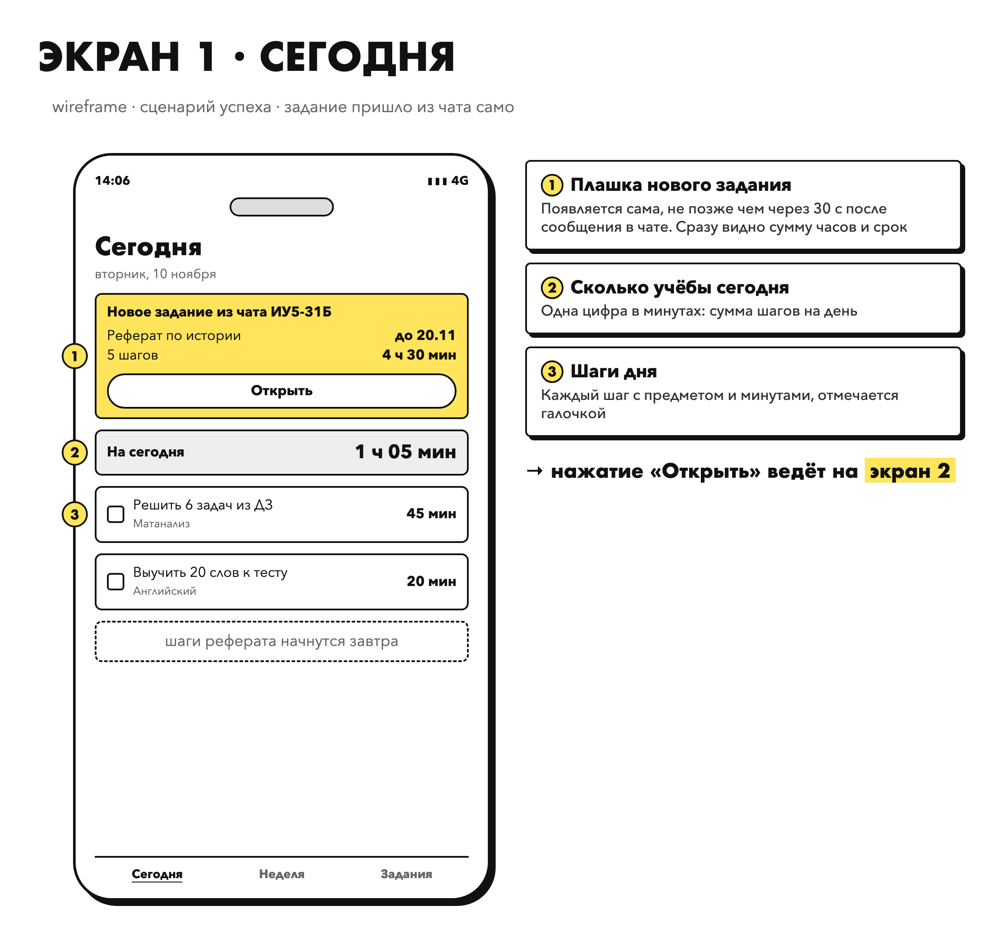

**Экран 2.** Аня открывает задание и видит шаги по дням.

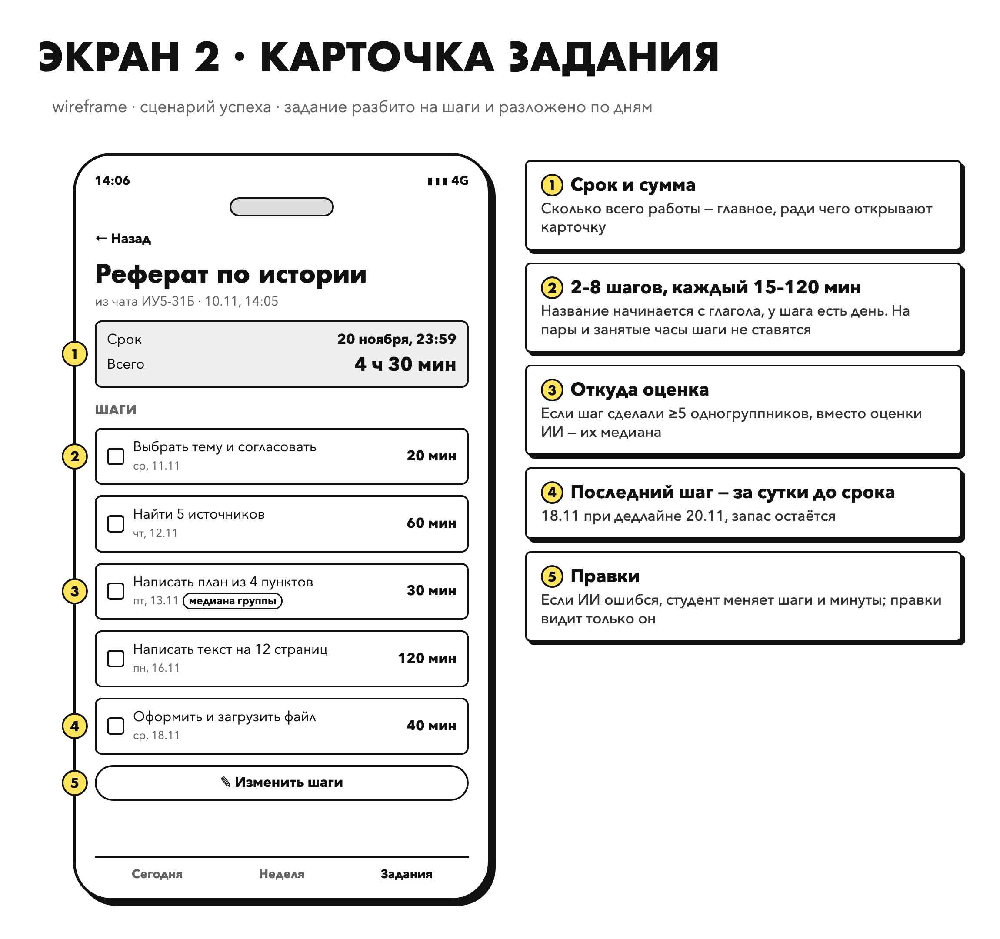

**Экран 3.** Тот же экран в сценарии отказа: до срока не хватает времени.

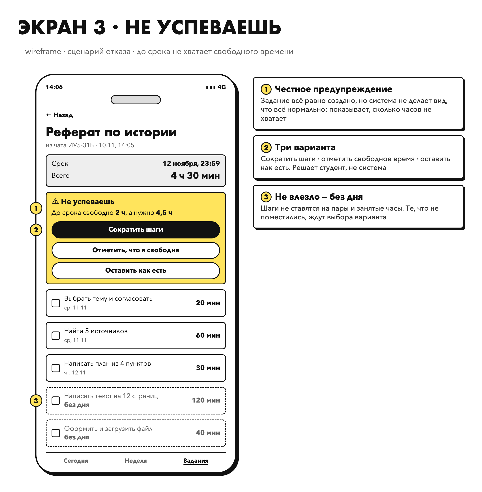

Выбирать ничего не обязательно: задание уже создано, а шаги, которые влезли, стоят в плане.

| Кнопка | Что происходит |
|---|---|
| Сократить шаги | Открывается редактор: можно уменьшить минуты или убрать шаг. План пересчитывается; если всё влезло, плашка исчезает |
| Отметить, что я свободна | Можно снять свою занятость в эти дни, например работу или спорт. Шаги без дня встают на освободившиеся часы |
| Оставить как есть | Студент принимает риск. Плашка сворачивается в метку "2 шага без дня", напоминаний больше нет. Если время освободится (отменили пару, шаг сделан быстрее), шаги встанут сами, и придёт сообщение |

На экране "Сегодня" шаги без дня в минуты дня не попадают, а пока выбор не сделан, сверху висит плашка "не успеваешь". На экране "Неделя" они собраны в блок "Без дня" внизу. На пары и занятые часы шаги не ставятся ни в одном из вариантов.

### Контракты API (API-First)

Сначала договариваемся о формате запроса и ответа, потом пишем код. Тогда приложение и бэкенд можно делать параллельно: пока бэкенда нет, приложение работает на заглушке с этим JSON. От языка и фреймворка контракт не зависит.

Обе ручки лежат на критическом пути: первая создаёт задание, вторая показывает, как оно легло в неделю (US-07).

#### `POST /api/v1/tasks` · новое задание → шаги

Вызывает бот, когда видит задание в чате, или приложение, когда студент присылает фото.

**Запрос**

```json
{
  "group_id": "grp_7f3a",
  "source": "telegram_chat",
  "text": "Реферат по истории к 20.11, 10–15 страниц",
  "message_id": 48211,
  "received_at": "2026-11-10T14:05:00+03:00"
}
```

**Ответ `201 Created`: всё влезает** (сценарий успеха, экран 2)

```json
{
  "task_id": "tsk_9c21",
  "title": "Реферат по истории",
  "subject": "История",
  "deadline": "2026-11-20T23:59:00+03:00",
  "total_minutes": 270,
  "fits": true,
  "warning": null,
  "steps": [
    { "step_id": "stp_1", "title": "Выбрать тему и согласовать", "minutes": 20, "planned_date": "2026-11-11", "estimate_source": "ai" },
    { "step_id": "stp_2", "title": "Найти 5 источников", "minutes": 60, "planned_date": "2026-11-12", "estimate_source": "ai" },
    { "step_id": "stp_3", "title": "Написать план из 4 пунктов", "minutes": 30, "planned_date": "2026-11-13", "estimate_source": "group_median" },
    { "step_id": "stp_4", "title": "Написать текст на 12 страниц", "minutes": 120, "planned_date": "2026-11-16", "estimate_source": "ai" },
    { "step_id": "stp_5", "title": "Оформить и загрузить файл", "minutes": 40, "planned_date": "2026-11-18", "estimate_source": "ai" }
  ]
}
```

**Ответ `201 Created`: не влезает** (сценарий отказа, экран 3)

```json
{
  "task_id": "tsk_9c22",
  "title": "Реферат по истории",
  "subject": "История",
  "deadline": "2026-11-12T23:59:00+03:00",
  "total_minutes": 270,
  "fits": false,
  "warning": {
    "code": "not_enough_time",
    "free_minutes_before_deadline": 120,
    "missing_minutes": 150,
    "options": ["shorten_steps", "mark_free_time", "keep_anyway"]
  },
  "steps": [
    { "step_id": "stp_1", "title": "Выбрать тему и согласовать", "minutes": 20, "planned_date": "2026-11-11", "estimate_source": "ai" },
    { "step_id": "stp_2", "title": "Найти 5 источников", "minutes": 60, "planned_date": "2026-11-11", "estimate_source": "ai" },
    { "step_id": "stp_3", "title": "Написать план из 4 пунктов", "minutes": 30, "planned_date": "2026-11-12", "estimate_source": "group_median" },
    { "step_id": "stp_4", "title": "Написать текст на 12 страниц", "minutes": 120, "planned_date": null, "estimate_source": "ai" },
    { "step_id": "stp_5", "title": "Оформить и загрузить файл", "minutes": 40, "planned_date": null, "estimate_source": "ai" }
  ]
}
```

Нехватка времени — это не ошибка: задание создано, поэтому код `201`, а проблему описывает поле `warning`. Ошибкой считаем только случай, когда задания в сообщении нет вовсе.

**Ответ `422 Unprocessable Entity`: задание не найдено**

```json
{
  "error": {
    "code": "task_not_recognized",
    "message": "В сообщении не найдено задание или срок"
  }
}
```

| Поле | Зачем |
|---|---|
| `fits` | Влезает ли задание до срока; от него зависит, показывать ли жёлтую плашку |
| `estimate_source` | `ai` или `group_median`: откуда взята оценка шага (ФТ-6 к US-05) |
| `planned_date: null` | Шаг не поместился и ждёт решения студента |
| `warning.options` | Какие кнопки показать на экране 3 |

#### `GET /api/v1/weeks/2026-11-09` · расклад недели

Тело запроса не нужно: неделя указана в пути (дата понедельника), студент определяется по токену в заголовке `Authorization`.

**Ответ `200 OK`** (в примере три дня из семи)

```json
{
  "week_start": "2026-11-09",
  "week_end": "2026-11-15",
  "study_hours": 7.0,
  "free_hours": 68.0,
  "days": [
    { "date": "2026-11-09", "classes_hours": 6.0, "steps_hours": 1.0, "busy_hours": 0.0, "free_hours": 9.0, "overload": null },
    { "date": "2026-11-12", "classes_hours": 6.0, "steps_hours": 3.5, "busy_hours": 0.0, "free_hours": 6.5,
      "overload": { "extra_hours": 0.5, "suggest_move_to": "2026-11-15" } },
    { "date": "2026-11-15", "classes_hours": 0.0, "steps_hours": 0.0, "busy_hours": 0.0, "free_hours": 16.0, "overload": null }
  ],
  "unplaced_steps": [],
  "updated_at": "2026-11-10T08:00:00+03:00"
}
```

| Поле | Откуда требование (US-07) |
|---|---|
| `study_hours`, `free_hours` | ФТ-1: две цифры за неделю, округление до 0,5 ч |
| `classes_hours` отдельно от `steps_hours` | ФТ-2: пары не входят в "учёбу" |
| четыре поля `*_hours` у дня | ФТ-4: полоса из четырёх частей |
| `overload` | ФТ-6: больше 3 ч шагов → предложение перенести на самый свободный день |
| `unplaced_steps` | Блок "Без дня": шаги, которые не влезли до срока (сценарий отказа) |
| `updated_at` | НФТ "Офлайн": без сети показываем, когда расклад обновлялся |

В сценарии отказа `unplaced_steps` не пустой:

```json
"unplaced_steps": [
  { "step_id": "stp_4", "task_id": "tsk_9c22", "title": "Написать текст на 12 страниц", "minutes": 120, "deadline": "2026-11-12T23:59:00+03:00", "kept_anyway": true },
  { "step_id": "stp_5", "task_id": "tsk_9c22", "title": "Оформить и загрузить файл", "minutes": 40, "deadline": "2026-11-12T23:59:00+03:00", "kept_anyway": true }
]
```

`kept_anyway: true` значит, что студент нажал "Оставить как есть": вместо плашки показываем только метку.

---

## ПЗ-5 · C4 и стек технологий

### C1 · Контекст

Первый уровень: "Делу час" — один блок. Вокруг него три роли из ПЗ-3 и три внешние системы, без которых MVP не работает.

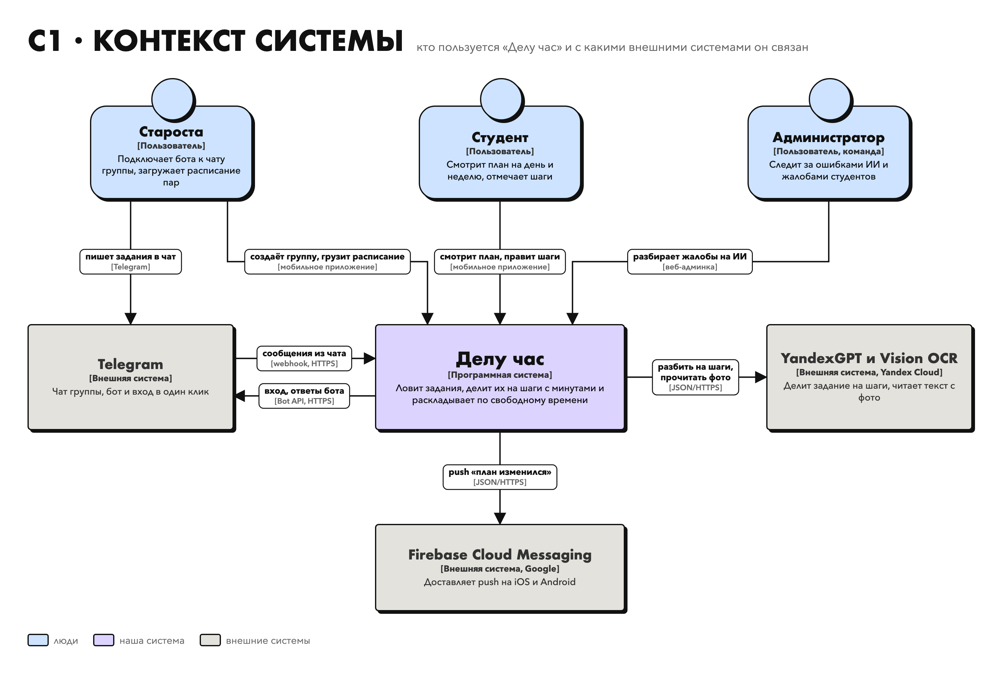

| Внешняя система | Зачем нужна |
|---|---|
| Telegram | Бот сидит в чате группы и ловит задания (US-04), через Telegram же вход в один клик (US-01) |
| YandexGPT и Vision OCR | Разбивка задания на шаги (US-05) и текст с фото доски (US-08) |
| Firebase Cloud Messaging | Push на iOS и Android, когда план изменился |

### C2 · Контейнеры

Второй уровень: что крутится внутри и как части говорят друг с другом. Пять доменных зон из ПЗ-4 живут в одном API как отдельные модули. Делить их на микросервисы для MVP рано: команда маленькая, нагрузка небольшая, а границы зон уже проведены, так что разрезать потом будет несложно.

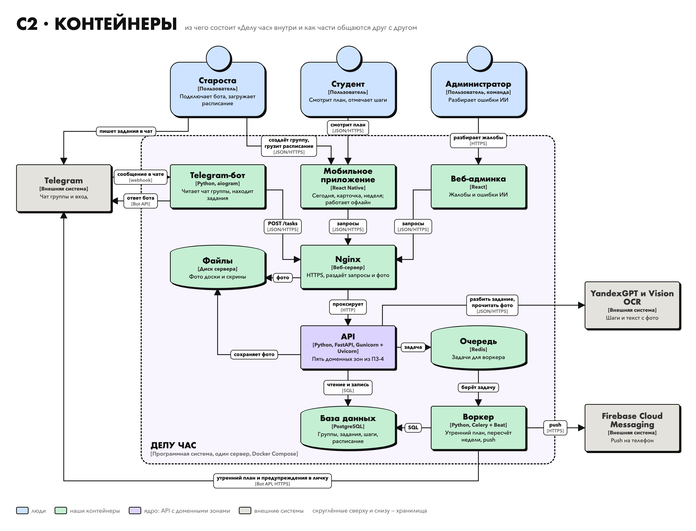

Два пути через схему:
- **Задание из чата.** Telegram → бот → `POST /tasks` → API спрашивает YandexGPT и сохраняет шаги в PostgreSQL. Ответа от ИИ ждём прямо в запросе: это 5–15 секунд, а по сценарию BDD у нас есть 30.
- **Утренний план.** В 8:00 Celery Beat ставит задачу, воркер берёт её из Redis, собирает план на день каждому студенту и отправляет в личку и push. Если делать это внутри API, тысяча сообщений подряд подвесит ответы приложению.

### Стек MVP

| Часть | Выбор | Почему | Почему не другое |
|---|---|---|---|
| Бэкенд | Python, FastAPI | У Python лучшие библиотеки для работы с ИИ. FastAPI асинхронный: пока ждём ответа YandexGPT, сервер обслуживает других. Документацию API строит сам по контрактам из ПЗ-4 | Django тянет шаблоны и формы, которые нам не нужны: экраны рисует приложение. Go быстрее, но для MVP скорость Python хватает с запасом |
| Запуск API | Gunicorn + Uvicorn | Gunicorn держит несколько процессов и перезапускает упавший, Uvicorn внутри каждого обрабатывает асинхронные запросы | Один Uvicorn без Gunicorn: если процесс упал, сервис лежит |
| Telegram-бот | aiogram | Асинхронный, как и FastAPI, и на том же Python: модели и код общие | — |
| База данных | PostgreSQL | Данные связаны: группа → задание → шаги → расписание. Медиану группы (ФТ-6) считает одна SQL-функция | MongoDB: связи между документами пришлось бы собирать вручную |
| Очередь | Celery + Redis | Рассылка в 8:00 и пересчёт недели уходят в фон и не тормозят API. Celery Beat запускает задачи по расписанию | RabbitMQ и Kafka рассчитаны на огромные потоки событий, нам столько не нужно. Очередь в самой PostgreSQL не умеет запускать задачи по расписанию |
| Файлы | Диск сервера + Nginx | Фото доски весят мало, хранить их на том же сервере дёшево и просто | S3 (Yandex Object Storage) — когда серверов станет больше одного |
| Веб-сервер | Nginx | HTTPS, проксирует запросы в API, сам отдаёт фото | — |
| Приложение | React Native | Один код для iOS и Android. Есть локальное хранилище для офлайн-режима (НФТ "Офлайн") и виджет для US-14 | Swift + Kotlin — два приложения и вдвое больше работы. Telegram Mini App — нет виджета и офлайна |
| Админка | React | Та же библиотека, что и в приложении, общие компоненты | — |
| ИИ | YandexGPT, Vision OCR | Данные остаются в России (152-ФЗ), в договоре можно запретить обучение на наших текстах (НФТ "Приватность") | Зарубежные модели: персональные данные студентов уходят за границу |
| Развёртывание | Docker Compose, один сервер | Все контейнеры C2 поднимаются одной командой | Kubernetes — когда понадобится несколько серверов |

**Платежи в MVP не нужны:** после pivot студенту приложение бесплатно, а партнёры платят по счёту. Когда появится подписка по желанию, подключим ЮKassa: оплата по deep link, статус узнаём через webhook, а приложение опрашивает сервер, пока платёж не подтвердится.
